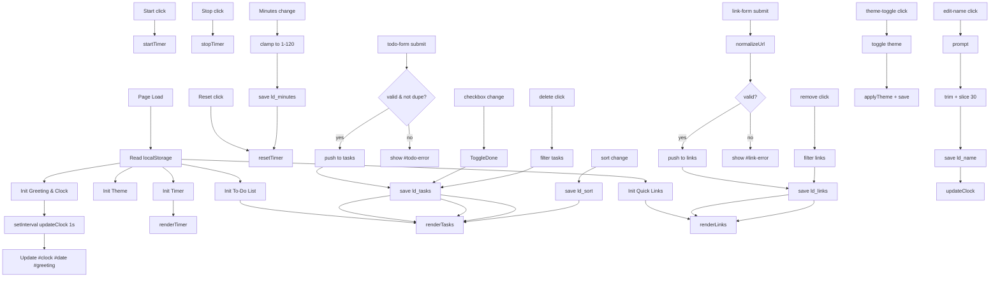

# Design Document

## Overview

The To-Do List Life Dashboard is a single-page, client-side web application delivered as three files: `index.html`, `css/style.css`, and `js/script.js`. It has no backend, no build step, and no external dependencies. All state is persisted in `localStorage`. The page combines four functional widgets — a Greeting/Clock, a Focus Timer, a To-Do List, and a Quick Links launcher — plus a Light/Dark theme toggle.

The JavaScript is organised as a flat module pattern: a set of named functions and module-level variables grouped by feature, executed in a single IIFE-free script. No classes, no frameworks, no ES module syntax (which would require a build tool or server). Event listeners are registered once at page load; rendering is done imperatively via DOM manipulation.

---

## Architecture

### File Layout

```
index.html          — markup skeleton, widget containers, one <script> tag
css/style.css       — CSS custom properties for theming, layout, component styles
js/script.js        — all application logic, one file, plain ES5/ES6 vanilla JS
```

### Script Organisation

`script.js` is divided into labelled sections, executed top-to-bottom on page load:

```
1. Storage helpers       load() / save() wrappers around localStorage
2. DOM helper            $(id) shorthand
3. Greeting & Clock      state, getGreeting(), updateClock(), edit-name listener
4. Theme                 applyTheme(), initial detection, toggle listener
5. Focus Timer           state machine variables, start/stop/reset, renderTimer(), listeners
6. To-Do List            state, isDuplicate(), sortedTasks(), renderTasks(), form listeners
7. Quick Links           state, normalizeUrl(), renderLinks(), form listeners
8. Init                  initial render calls, setInterval for clock
```

Each section is self-contained. Sections share only the `load`/`save` helpers and the `$` shorthand.

### Rendering Model

All widgets use direct DOM mutation (`.innerHTML = ''` then `appendChild` loops, or direct `textContent` assignment). There is no virtual DOM. `renderTasks()` and `renderLinks()` are full re-renders triggered by any state change. `updateClock()` updates only the three clock/date/greeting text nodes.

---

## Components and Interfaces

### Storage Helpers

```js
load(key: string, fallback: any) → any
save(key: string, value: any) → void
```

`load` calls `JSON.parse` inside a try/catch, returning `fallback` on any failure (missing key, parse error, storage unavailable). `save` calls `JSON.stringify` inside a try/catch and silently swallows errors (storage unavailable — the app continues to work for the session).

### Greeting & Clock Module

**State:** `userName: string` (loaded from `localStorage` on startup)

**Functions:**
- `getGreeting(hour: number) → string` — pure function, hour 0–23 → one of four greeting strings
- `updateClock() → void` — reads `new Date()`, updates three DOM nodes (`#clock`, `#date`, `#greeting`), applies greeting + name formatting

**Events:**
- `#edit-name click` — prompts the user, trims and slices to 30 chars, saves, calls `updateClock()`

**Timer:** `setInterval(updateClock, 1000)` started in the Init section

### Theme Module

**State:** `theme: 'light' | 'dark'` (loaded from `localStorage`; fallback = `window.matchMedia('(prefers-color-scheme: dark)').matches ? 'dark' : 'light'`)

**Functions:**
- `applyTheme(theme) → void` — sets `document.documentElement.setAttribute('data-theme', theme)` and updates button text

**Events:**
- `#theme-toggle click` — flips theme, calls `applyTheme`, saves

### Focus Timer Module

**State:**
```
timerMinutes: number    — configured session length (1–120)
remaining: number       — seconds left in current session
timerId: number | null  — handle returned by setInterval, null when stopped
```

**Functions:**
- `startTimer()` — no-op if `timerId` is set or `remaining ≤ 0`; starts `setInterval` decrementing `remaining` each second; calls `stopTimer` + `alert` at zero
- `stopTimer()` — calls `clearInterval(timerId)`, sets `timerId = null`, calls `renderTimer()`
- `resetTimer()` — calls `stopTimer()`, sets `remaining = timerMinutes * 60`, calls `renderTimer()`
- `renderTimer()` — formats `remaining` as MM:SS (zero-padded), writes to `#timer-display`, updates `document.title`

**Events:**
- `#timer-start click` → `startTimer()`
- `#timer-stop click` → `stopTimer()`
- `#timer-reset click` → `resetTimer()`
- `#timer-minutes change` → clamps value to [1, 120], updates `timerMinutes`, saves, calls `resetTimer()`

### To-Do List Module

**State:**
```
tasks: Array<{id: number, text: string, done: boolean}>
sortMode: 'newest' | 'oldest' | 'az' | 'za' | 'pending' | 'done'
editingId: number | null
```

**Functions:**
- `isDuplicate(text, ignoreId?) → boolean` — case-insensitive, whitespace-trimmed match against all tasks except the one with `ignoreId`
- `sortedTasks() → Task[]` — returns a sorted shallow copy of `tasks` based on `sortMode`
- `renderTasks() → void` — full DOM re-render of `#todo-list`
- `saveTasks() → void` — calls `save(KEYS.tasks, tasks)`

**Events:**
- `#todo-form submit` — validates, checks duplicate, appends task, saves, renders
- `#todo-sort change` — updates `sortMode`, saves, renders
- Checkbox `change` — updates `task.done`, saves, renders
- Edit save / cancel inline — validates, checks duplicate, updates `task.text`, saves, renders

### Quick Links Module

**State:**
```
links: Array<{id: number, name: string, url: string}>
```

Default value (used only when no `localStorage` key exists):
```js
[
  { id: 1, name: 'Google',  url: 'https://www.google.com' },
  { id: 2, name: 'GitHub',  url: 'https://github.com' },
  { id: 3, name: 'YouTube', url: 'https://www.youtube.com' }
]
```

**Functions:**
- `normalizeUrl(value: string) → string | null` — trims input, prepends `https://` if no protocol, attempts `new URL()` parse, returns `null` if hostname has no `.` or parse throws
- `renderLinks() → void` — full DOM re-render of `#links`

**Events:**
- `#link-form submit` — validates name and normalised URL, appends link, saves, renders
- Remove button click — filters link out, saves, renders

---

## Data Models

All keys are stored under a shared prefix `ld_` to avoid collisions with other apps on the same origin.

| `localStorage` Key | Type | Default | Description |
|---|---|---|---|
| `ld_name` | `string` | `""` | Custom user name, max 30 chars |
| `ld_theme` | `"light" \| "dark"` | OS preference | Active theme |
| `ld_minutes` | `number` (1–120) | `25` | Timer session length in minutes |
| `ld_tasks` | `Task[]` | `[]` | All to-do tasks |
| `ld_sort` | `SortMode` | `"newest"` | Active sort order |
| `ld_links` | `Link[]` | `[Google, GitHub, YouTube]` | Saved quick links |

### Task Shape

```ts
{
  id: number,      // Date.now() at creation — millisecond timestamp, used as sort key
  text: string,    // 1–200 characters, trimmed
  done: boolean    // false = pending, true = complete
}
```

### Link Shape

```ts
{
  id: number,      // Date.now() at creation
  name: string,    // 1–50 characters, trimmed
  url: string      // Normalised absolute URL, 1–2000 characters
}
```

### Sort Modes

| Value | Comparator |
|---|---|
| `"newest"` | `b.id - a.id` |
| `"oldest"` | `a.id - b.id` |
| `"az"` | `a.text.localeCompare(b.text)` |
| `"za"` | `b.text.localeCompare(a.text)` |
| `"pending"` | `a.done - b.done` then `b.id - a.id` |
| `"done"` | `b.done - a.done` then `b.id - a.id` |

---

## Correctness Properties

*A property is a characteristic or behavior that should hold true across all valid executions of a system — essentially, a formal statement about what the system should do. Properties serve as the bridge between human-readable specifications and machine-verifiable correctness guarantees.*

### Property 1: Greeting function covers all 24 hours

*For any* integer hour in [0, 23], `getGreeting(hour)` returns exactly one of `"Good night"`, `"Good morning"`, `"Good afternoon"`, or `"Good evening"`, and the returned value matches the range the hour falls in (0–4 → night, 5–11 → morning, 12–17 → afternoon, 18–23 → evening).

**Validates: Requirements 1.2**

### Property 2: Greeting format with and without name

*For any* greeting string `g` and any name string `n` (including the empty string), the formatted greeting output equals `n.length > 0 ? g + ", " + n + "!" : g + "!"`. No other formatting is ever produced.

**Validates: Requirements 1.3**

### Property 3: Name truncation invariant

*For any* string `s`, after the name-save operation the stored name has length ≤ 30 and equals `s.trim().slice(0, 30)`. Strings already ≤ 30 characters after trimming are stored unchanged.

**Validates: Requirements 1.5**

### Property 4: Timer display format

*For any* integer `n` in [0, 7200] (seconds), `formatTime(n)` produces a string matching `/^\d{2}:\d{2}$/` where the minutes part equals `Math.floor(n / 60)` zero-padded to two digits and the seconds part equals `n % 60` zero-padded to two digits.

**Validates: Requirements 2.2**

### Property 5: Timer reset restores configured length

*For any* `timerMinutes` value `v` in [1, 120], after `resetTimer()` is called, `remaining === v * 60`, regardless of how much time had previously elapsed.

**Validates: Requirements 2.4**

### Property 6: Timer minutes clamping

*For any* integer `v`, `clamp(v, 1, 120)` returns `1` when `v < 1`, returns `120` when `v > 120`, and returns `v` when `v` is in [1, 120]. The result is always in [1, 120].

**Validates: Requirements 2.9**

### Property 7: Task list growth on valid add

*For any* tasks array and any non-empty task text that is not a duplicate, after adding the task the array length increases by exactly 1 and the new task's text equals the submitted text (trimmed).

**Validates: Requirements 3.1**

### Property 8: Duplicate detection is case- and whitespace-insensitive

*For any* tasks array containing task `t` and any string `s` where `s.trim().toLowerCase() === t.text.trim().toLowerCase()`, `isDuplicate(s)` returns `true`. For any string `s` where no existing task matches after normalisation, `isDuplicate(s)` returns `false`.

**Validates: Requirements 3.8, 3.9**

### Property 9: Task deletion removes exactly the target

*For any* tasks array and any task `t` in that array, after deleting `t` the resulting array does not contain any task with `id === t.id` and the length is reduced by exactly 1.

**Validates: Requirements 3.6**

### Property 10: Sort order invariants

*For any* tasks array and each supported sort mode, every adjacent pair of tasks `(sorted[i], sorted[i+1])` in the sorted result satisfies the comparator for that mode:
- `newest`: `sorted[i].id >= sorted[i+1].id`
- `oldest`: `sorted[i].id <= sorted[i+1].id`
- `az`: `sorted[i].text.localeCompare(sorted[i+1].text) <= 0`
- `za`: `sorted[i].text.localeCompare(sorted[i+1].text) >= 0`
- `pending`: `sorted[i].done <= sorted[i+1].done` (treating false=0, true=1); when done values are equal, `sorted[i].id >= sorted[i+1].id`
- `done`: `sorted[i].done >= sorted[i+1].done`; when done values are equal, `sorted[i].id >= sorted[i+1].id`

**Validates: Requirements 3.10**

### Property 11: localStorage round-trip preserves data

*For any* valid tasks array `A`, `JSON.parse(JSON.stringify(A))` produces an array structurally equivalent to `A` (same length, same `id`, `text`, and `done` values at each index). The same holds for a links array `L`.

**Validates: Requirements 3.7, 4.5, 4.6**

### Property 12: URL normalisation prepends https when no protocol

*For any* URL string `s` that does not start with `http://` or `https://` and that represents a valid host (hostname contains `.`), `normalizeUrl(s)` returns a string starting with `https://`.

**Validates: Requirements 4.9**

### Property 13: Invalid URLs produce null

*For any* string that cannot be parsed as a valid absolute URL with a dotted hostname (after optional `https://` prepending), `normalizeUrl(s)` returns `null`.

**Validates: Requirements 4.8**

### Property 14: Theme toggle is a round trip

*For any* initial theme value `t` in `{'light', 'dark'}`, toggling the theme twice returns to the original value `t`. More precisely: `toggle(toggle(t)) === t`.

**Validates: Requirements 5.1, 5.3**

---

## Error Handling

### localStorage Unavailability

`load` and `save` are wrapped in try/catch. If `localStorage` throws (private browsing mode, storage quota exceeded, security policy), `load` returns its fallback value and `save` silently does nothing. The app continues to function for the current session with in-memory state only. This satisfies Requirements 3.11 and 5.6.

### Parse Errors

`load` returns the fallback value on `JSON.parse` failure. The tasks widget initialises to `[]` with `sortMode = 'newest'` in this case (Requirement 3.11).

### Invalid Timer Input

`parseInt` failure defaults to 25; the result is then clamped to [1, 120] (Requirement 2.9). The `NaN` guard uses `|| 25` as the fallback: `parseInt(e.target.value, 10) || 25`.

### Empty / Invalid Form Submissions

Each form handler validates input before mutating state:
- Empty task text: form `required` attribute provides first-line prevention; JS guard provides second.
- Duplicate task text: `isDuplicate()` check with inline error message on `#todo-error`.
- Empty link name: guard before array mutation.
- Invalid URL: `normalizeUrl()` returns `null`; error message shown on `#link-error`; link not added.

### XSS Prevention

Task text and link names are written via `element.textContent`, never `innerHTML`. Link `href` values are set via `element.href` (the DOM attribute, not innerHTML), which the browser validates. This prevents script injection from user-supplied content.

---

## Testing Strategy

### Approach

The feature is primarily pure-function logic and DOM manipulation. PBT is appropriate for the pure functions (greeting classification, time formatting, clamping, duplicate detection, sort ordering, URL normalisation). UI rendering and browser API interactions (localStorage, matchMedia, setInterval) are covered by example-based unit tests and manual smoke tests.

**Property-based testing library:** [fast-check](https://fast-check.dev/) (JavaScript, runs in Node.js with any test runner; zero browser dependency for pure function tests).

### Unit Tests (example-based)

Cover the following specific scenarios:
- Timer initial state: `timerMinutes === 25`, `remaining === 1500`
- Start while running: second `startTimer()` call does not create a second interval
- Start at zero: `startTimer()` with `remaining === 0` is a no-op
- Stop pauses at current value
- Empty edit is discarded without touching localStorage
- Default links appear when no key exists in localStorage
- Empty link name shows error and does not add link
- Theme defaults to OS preference when no key exists

### Property-Based Tests (fast-check, minimum 100 iterations each)

Each test is tagged with a comment referencing its design property:

| Test Tag | Property |
|---|---|
| `Feature: todo-life-dashboard, Property 1: greeting covers all hours` | Property 1 |
| `Feature: todo-life-dashboard, Property 2: greeting format with/without name` | Property 2 |
| `Feature: todo-life-dashboard, Property 3: name truncation invariant` | Property 3 |
| `Feature: todo-life-dashboard, Property 4: timer display format` | Property 4 |
| `Feature: todo-life-dashboard, Property 5: timer reset restores length` | Property 5 |
| `Feature: todo-life-dashboard, Property 6: timer minutes clamping` | Property 6 |
| `Feature: todo-life-dashboard, Property 7: task list growth on valid add` | Property 7 |
| `Feature: todo-life-dashboard, Property 8: duplicate detection normalisation` | Property 8 |
| `Feature: todo-life-dashboard, Property 9: task deletion removes exactly one` | Property 9 |
| `Feature: todo-life-dashboard, Property 10: sort order invariants` | Property 10 |
| `Feature: todo-life-dashboard, Property 11: localStorage round-trip` | Property 11 |
| `Feature: todo-life-dashboard, Property 12: URL normalisation prepends https` | Property 12 |
| `Feature: todo-life-dashboard, Property 13: invalid URLs produce null` | Property 13 |
| `Feature: todo-life-dashboard, Property 14: theme toggle round trip` | Property 14 |

### Manual / Smoke Tests

Verify the following in a real browser (Chrome, Firefox, Edge, Safari, two most recent versions each):
- Page renders correctly in light and dark mode
- Clock ticks every second
- Timer counts down and shows browser alert at zero
- All four widgets render in the correct grid layout
- Responsive layout at ≤ 720 px viewport width
- localStorage persistence across a full page reload
- Font size is at least 14 px for body text
- Two distinct heading levels are visible (H1 for clock, H2 for widget titles)
- Maximum page width does not exceed 1200 px

### Mermaid: Widget Interaction Flow


